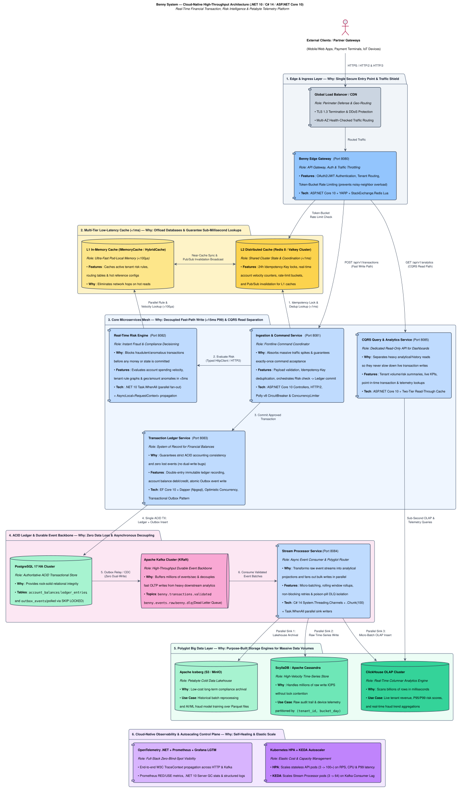

# Project Benny — Cloud-Native High-Throughput Event, Risk & Transaction Platform

**Project Benny** is a reference cloud-native distributed system engineered on the modern .NET stack (**.NET 10**, **C# 14**, **ASP.NET Core 10**). It is designed for **99.99%+ High Availability**, **sub-15ms P99 Fast-Path Latency**, **elastic horizontal scaling**, **durable fault tolerance**, and **petabyte-scale event/data processing**.

---

## 1. System Concept & Use Case

Project Benny acts as a **Real-Time Global Transaction, Risk Intelligence & Telemetry Engine** capable of handling extreme traffic bursts (e.g., instant payment clearing, real-time fraud detection, high-frequency IoT/financial telemetry, or flash-sale order orchestration):

1. **Ultra-Low Latency Synchronous Fast Path (<15ms P99)**:
   - Requests enter through **Benny Edge Gateway** (Rate Limiting, OAuth2/JWT, mTLS, YARP) into the **Ingestion Service** (ASP.NET Core 10 Web API Controllers on Kestrel).
   - **Idempotency Barrier**: Deduplicates retries in `<1ms` using a **Two-Tier Near-Cache** (`L1 IMemoryCache / HybridCache` + `L2 Redis 8 / Valkey Cluster` via `StackExchange.Redis`).
   - **Parallel Risk Decisioning**: The **Risk Engine** uses **Structured Parallel Tasks (`Task.WhenAll` with linked `CancellationTokenSource` deadlines)** and **`AsyncLocal<RequestContext>`** to evaluate velocity counters, rule graphs, and anomaly scores in parallel within a strict 5ms deadline.
   - **Atomic State + Event Durability**: The **Ledger Service** commits state changes and an **Outbox Event** in a single ACID transaction on **PostgreSQL 17** (`EF Core 10` / `Npgsql`), preventing dual-write bugs.
2. **High-Throughput Asynchronous Event & Big Data Plane**:
   - Outbox events stream via **Debezium CDC / SKIP LOCKED Outbox Relay** into **Apache Kafka (KRaft)** partitioned topics with **Avro/Protobuf Schema Registry**.
   - **Stream Processor** pods (autoscale-driven by **KEDA** on Kafka consumer lag) use **`System.Threading.Channels` & `.Chunk(100)`** for micro-batching and fan out writes to:
     - **ScyllaDB / Apache Cassandra**: High-velocity raw time-series event storage.
     - **ClickHouse**: Real-time columnar OLAP store for sub-second analytics over billions of rows.
     - **Apache Iceberg (S3 / MinIO)**: Cold lakehouse storage for historical batch & AI/ML pipelines.
3. **CQRS Read Plane**:
   - **Query & Analytics Service** serves real-time materialized views and analytical queries backed by ClickHouse, ScyllaDB, and Redis read-through caches.

---

## 2. System Architecture Diagrams (PlantUML)

All architecture diagrams are maintained as code in [`docs/architecture/`](docs/architecture/) and compiled to SVG and PNG formats:

### 2.1 Overall Cloud-Native System Architecture
- Source: [`docs/architecture/system-architecture.puml`](docs/architecture/system-architecture.puml)
- Rendered: [`docs/architecture/system-architecture.svg`](docs/architecture/system-architecture.svg) | [`docs/architecture/system-architecture.png`](docs/architecture/system-architecture.png)



### 2.2 Low-Latency Request & Durable Event Sequence Flow
- Source: [`docs/architecture/data-flow-sequence.puml`](docs/architecture/data-flow-sequence.puml)
- Rendered: [`docs/architecture/data-flow-sequence.svg`](docs/architecture/data-flow-sequence.svg) | [`docs/architecture/data-flow-sequence.png`](docs/architecture/data-flow-sequence.png)


### 2.3 Multi-AZ High Availability, Resilience & Horizontal Scaling Topology
- Source: [`docs/architecture/scaling-resilience-topology.puml`](docs/architecture/scaling-resilience-topology.puml)
- Rendered: [`docs/architecture/scaling-resilience-topology.svg`](docs/architecture/scaling-resilience-topology.svg) | [`docs/architecture/scaling-resilience-topology.png`](docs/architecture/scaling-resilience-topology.png)


---

## 3. AI-Native Project Structure (`.agents/` & `AGENTS.md`)

This repository follows best practices for AI-assisted software engineering:

```text
benny-system/
├── AGENTS.md                                      # Root AI Agent Constitution & Architecture Rules
├── README.md                                      # Project Overview & Architecture Guide
├── .agents/
│   ├── rules/
│   │   └── dotnet10-csharp14-standards.md         # .NET 10, C# 14 & ASP.NET Core 10 Rules
│   ├── agents/                                    # Specialized AI Subagent Personas
│   │   ├── cloud-architect.md                     # Principal Cloud-Native System Architect
│   │   ├── dotnet-microservice-engineer.md        # Staff .NET 10 & C# 14 Microservice Engineer
│   │   ├── data-streaming-specialist.md           # Principal Cache, Kafka & Polyglot Data Engineer
│   │   └── sre-resilience-auditor.md              # Principal SRE, Autoscaling & Chaos Engineer
│   ├── skills/                                    # On-Demand Procedural Skills (SKILL.md)
│   │   ├── scaffold-dotnet-service/SKILL.md       # Scaffolds .NET 10 + ASP.NET Core 10 services
│   │   ├── implement-caching-messaging/SKILL.md   # L1/L2 Near-Cache + Outbox + Kafka DLQ patterns
│   │   ├── resilience-and-scaling-audit/SKILL.md  # Polly v8 + KEDA/HPA + Server GC/PGO checklist
│   │   └── plantuml-architecture-sync/SKILL.md    # Updates & renders PlantUML diagrams
│   └── prompts/                                   # Reusable Project & Phase Prompts
│       ├── 00-master-project-prompt.md            # Master System Prompt for Project Benny
│       ├── 01-bootstrap-dotnet-monorepo.md        # Phase 1: .NET 10 Solution, CPM & Infra
│       ├── 02-implement-core-services.md          # Phase 2: Fast-Path Microservices
│       ├── 03-implement-data-and-streaming.md     # Phase 3: Kafka Streaming & Polyglot Data
│       └── 04-load-testing-and-chaos-engineering.md # Phase 4: K8s HPA/KEDA & Chaos Testing
└── docs/
    ├── implementation_plan.md                     # End-to-End Implementation Plan
    └── architecture/                              # PlantUML (.puml) sources + .svg & .png diagrams
        ├── system-architecture.puml
        ├── data-flow-sequence.puml
        └── scaling-resilience-topology.puml
```
