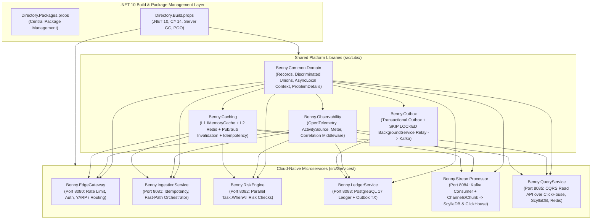

# Implementation Plan — Project Benny: Cloud-Native Real-Time Event, Risk & Transaction Platform

## Goal Description

Implement **Project Benny** end-to-end as a production-grade, cloud-native distributed system built on **.NET 10**, **C# 14**, and **ASP.NET Core 10**.

The system demonstrates industry best practices for:
- **High Availability (99.99%+ SLA)** & **Ultra-Low Latency (<15ms P99 Fast Path)** using **ASP.NET Core 10 Web API Controllers (`[ApiController]`, `ControllerBase` — no Minimal APIs)**, **Non-Blocking `ValueTask` / `Task` Concurrency**, **Structured Parallel Fan-Out (`Task.WhenAll` with linked `CancellationTokenSource` deadlines)**, **`AsyncLocal<RequestContext>`**, **`System.Threading.Channels`**, and **.NET 10 Server GC + Dynamic PGO (`TieredPGO`)**.
- **Two-Tier Near-Cache (`L1 IMemoryCache / HybridCache` + `L2 Redis 8 Cluster`)** with Redis Pub/Sub invalidation across horizontally scaled pods, single-flight stampede protection, and atomic Lua-based **Idempotency-Key** barriers.
- **Durable Event Streaming (`Apache Kafka KRaft`) & Zero Dual-Write (`Transactional Outbox Pattern`)** with non-blocking retries and Dead Letter Queue (`benny.dlq`) routing.
- **Massive Data & Polyglot Persistence**:
  - **PostgreSQL 17**: ACID transactional ledger & outbox store (`EF Core 10` + `Npgsql` + SQL migrations).
  - **Redis 8 / Valkey**: Distributed L2 cache, velocity counters, idempotency locks, and token-bucket rate limiting (`StackExchange.Redis`).
  - **ScyllaDB / Apache Cassandra**: Wide-column high-velocity raw telemetry & time-series store (`CassandraCSharpDriver`).
  - **ClickHouse**: Columnar real-time OLAP store for sub-second analytical aggregations over billions of events (`ClickHouse.Client`).
- **Elastic Horizontal Scaling & Fault Tolerance**: **Polly v8 (`Microsoft.Extensions.Resilience` & `Microsoft.Extensions.Http.Resilience`)** (CircuitBreaker, ConcurrencyLimiter/Bulkhead, Timeout, RateLimiter, Retry with Jitter), **OpenTelemetry .NET (`ActivitySource` & `Meter`)**, **Docker Compose** local cloud stack, and **Kubernetes HPA + KEDA** manifests.

---

## User Review Required

> [!IMPORTANT]
> **Aligned Architectural Decisions**:
> 1. **Full 4-Phase Scope**: We will build the complete multi-project .NET 10 monorepo solution (`BennySystem.sln`) including root MSBuild conventions (`Directory.Build.props`, `Directory.Packages.props`), 4 shared platform libraries (`src/Libs/*`), all 6 microservices (`src/Services/*`), local `docker-compose.yml` infrastructure, Kubernetes/KEDA manifests (`deploy/k8s/*`), and automated tests (`tests/*`).
> 2. **Synchronous Inter-Service Protocol**: Internal fast-path calls (`Edge Gateway -> Ingestion -> Risk Engine & Ledger`) will use **ASP.NET Core 10 Web API Controllers (`[ApiController]`) + Typed `HttpClient` over HTTP/2 (`SocketsHttpHandler`)** with Source-Generated `System.Text.Json`, protected by `Microsoft.Extensions.Http.Resilience` pipelines and W3C `traceparent` propagation. Minimal APIs are strictly avoided across all microservices.
> 3. **.NET 10 & C# 14 Optimization Flags**: Root `Directory.Build.props` will enforce `TargetFramework=net10.0`, `LangVersion=14.0`, `ServerGarbageCollection=true`, `GarbageCollectionAdaptationMode=1` (DATAS), and `TieredPGO=true` across all service projects.

---

## System Module & Dependency Architecture



---

## Proposed Changes

### Component 1: .NET 10 Solution & MSBuild Conventions (Phase 1A)

Set up the root .NET 10 solution (`BennySystem.sln`), SDK config (`global.json`), MSBuild conventions (`Directory.Build.props`), and Central Package Management (`Directory.Packages.props`).

#### [NEW] [BennySystem.sln](file:///home/boris/devspace/benny-system/BennySystem.sln)
- Defines solution folders `src/Libs`, `src/Services`, and `tests`, referencing all 4 shared libraries, 6 microservices, and test projects:
  - `src/Libs/Benny.Common.Domain`
  - `src/Libs/Benny.Observability`
  - `src/Libs/Benny.Caching`
  - `src/Libs/Benny.Outbox`
  - `src/Services/Benny.EdgeGateway`
  - `src/Services/Benny.IngestionService`
  - `src/Services/Benny.RiskEngine`
  - `src/Services/Benny.LedgerService`
  - `src/Services/Benny.StreamProcessor`
  - `src/Services/Benny.QueryService`

#### [NEW] [global.json](file:///home/boris/devspace/benny-system/global.json)
- Pins the .NET 10 SDK (`10.0.100` with `rollForward: latestFeature`).

#### [NEW] [Directory.Build.props](file:///home/boris/devspace/benny-system/Directory.Build.props)
- Configures `TargetFramework=net10.0`, `LangVersion=14.0`, `Nullable=enable`, `ImplicitUsings=enable`, `TreatWarningsAsErrors=true`, `ServerGarbageCollection=true`, `GarbageCollectionAdaptationMode=1`, and `TieredPGO=true`.

#### [NEW] [Directory.Packages.props](file:///home/boris/devspace/benny-system/Directory.Packages.props)
- Centralizes NuGet package versions:
  - `Microsoft.AspNetCore.OpenApi` (`10.0.0`)
  - `Microsoft.Extensions.Http.Resilience` & `Microsoft.Extensions.Resilience` (`10.0.0`)
  - `Microsoft.Extensions.Caching.Hybrid` (`10.0.0`)
  - `Microsoft.EntityFrameworkCore` & `Npgsql.EntityFrameworkCore.PostgreSQL` (`10.0.0`)
  - `Dapper` (`2.1.66`)
  - `StackExchange.Redis` (`2.8.24`)
  - `Confluent.Kafka` (`2.8.0`)
  - `CassandraCSharpDriver` (`3.22.0`)
  - `ClickHouse.Client` (`7.11.0`)
  - `OpenTelemetry.Extensions.Hosting`, `OpenTelemetry.Instrumentation.AspNetCore`, `OpenTelemetry.Instrumentation.Http`, `OpenTelemetry.Exporter.Prometheus.AspNetCore`, `OpenTelemetry.Exporter.OpenTelemetryProtocol` (`1.11.1`)
  - `Yarp.ReverseProxy` (`2.3.0`)
  - `xunit.v3`, `Microsoft.NET.Test.Sdk`, `Testcontainers.*`, `NetArchTest.Rules`

---

### Component 2: Shared Platform Libraries (`src/Libs/*`) (Phase 1B)

Build the reusable building blocks shared across all microservices.

#### [NEW] [src/Libs/Benny.Common.Domain/Benny.Common.Domain.csproj](file:///home/boris/devspace/benny-system/src/Libs/Benny.Common.Domain/Benny.Common.Domain.csproj)
- Pure C# 14 domain primitives and contracts:
  - `Benny.Common.Domain.Context.RequestContext` (`readonly record struct` / `record` holding `CorrelationId`, `TenantId`, `IdempotencyKey`, `ReceivedAt`) and `RequestContextHolder` using **`AsyncLocal<RequestContext?>`**.
  - `TransactionCommand`, `RiskEvaluationRequest`, `RiskDecision` (`abstract record` discriminated union with `Approved`, `Rejected`, `ManualReviewRequired` sealed records), `LedgerEntryDto`, `TelemetryEventPayload`, `AnalyticsSummaryDto`.
  - `BennyJsonContext` (`JsonSerializerContext` source generator for zero-reflection serialization).
  - `BennyBusinessException` & standardized RFC 9457 `ProblemDetails` factory utilities.

#### [NEW] [src/Libs/Benny.Observability/Benny.Observability.csproj](file:///home/boris/devspace/benny-system/src/Libs/Benny.Observability/Benny.Observability.csproj)
- Reusable observability and error-handling extensions (`AddBennyObservability()`):
  - `RequestContextCorrelationMiddleware`: Binds incoming `X-Correlation-Id`, `X-Tenant-Id`, and `Idempotency-Key` headers into `RequestContextHolder.Current` via `AsyncLocal` and `Activity.Current` tags for every HTTP request, and propagates headers via a custom `DelegatingHandler` on outgoing `HttpClient` calls.
  - `GlobalProblemDetailsExceptionHandler` (`IExceptionHandler`): Translates validation errors, `BrokenCircuitException`, rate limit rejections, and domain errors into RFC 9457 `ProblemDetails` responses with W3C `traceId`.

#### [NEW] [src/Libs/Benny.Caching/Benny.Caching.csproj](file:///home/boris/devspace/benny-system/src/Libs/Benny.Caching/Benny.Caching.csproj)
- Multi-tier near-cache and idempotency engine (`AddBennyCaching()`):
  - `TwoTierNearCache<T>`: Combines **L1 `IMemoryCache`** (size limit, 30s expiration) + **L2 Redis (`IConnectionMultiplexer` / `IDatabase`)** + in-flight `ConcurrentDictionary<string, Lazy<Task<T>>>` single-flight coalescing to prevent cache stampedes.
  - `CacheInvalidationSubscriber` (`BackgroundService`): Listens and broadcasts key evictions over Redis Pub/Sub channel `benny:cache:invalidation` so all horizontally scaled pods immediately evict stale L1 keys.
  - `RedisIdempotencyService`: Atomic Lua script (`SET key IN_PROGRESS NX EX 60` -> stores completed response payload for 24h) preventing duplicate command execution under concurrent retries.

#### [NEW] [src/Libs/Benny.Outbox/Benny.Outbox.csproj](file:///home/boris/devspace/benny-system/src/Libs/Benny.Outbox/Benny.Outbox.csproj)
- Zero dual-write Transactional Outbox infrastructure (`AddBennyOutbox()`):
  - `OutboxEventEntity` & `IOutboxRepository` (using PostgreSQL `FOR UPDATE SKIP LOCKED` batch polling for concurrent pod safety).
  - `TransactionalOutboxPublisher`: Persists serialized event payloads inside the caller's active database transaction (`DbTransaction`).
  - `OutboxRelayBackgroundService` (`BackgroundService` + `PeriodicTimer`): Polls unpublished outbox rows in micro-batches, publishes asynchronously to Apache Kafka (`Confluent.Kafka` `IProducer<string, string>`) with `Acks.All` and W3C trace headers, and marks rows published.

---

### Component 3: Synchronous Fast-Path Microservices (`src/Services/*`) (Phase 2)

Implement the 4 microservices powering the `<15ms P99` synchronous request flow.

#### [NEW] [src/Services/Benny.EdgeGateway/Benny.EdgeGateway.csproj](file:///home/boris/devspace/benny-system/src/Services/Benny.EdgeGateway/Benny.EdgeGateway.csproj)
- **Benny Edge Gateway (`port 8080`)**:
  - `RedisTokenBucketRateLimiter`: Executes an atomic Redis Lua token-bucket script per `tenantId` / client IP (`X-RateLimit-Remaining` headers, HTTP `429 Too Many Requests` RFC 9457 `ProblemDetails` on burst exhaustion).
  - `EdgeGatewayController` (`[ApiController]`) / YARP: Routes `/api/v1/events/**` and `/api/v1/transactions/**` to `Benny.IngestionService` and `/api/v1/analytics/**` to `Benny.QueryService` via HTTP/2 `HttpClient` wrapped in Polly v8 CircuitBreaker and Timeout pipelines.

#### [NEW] [src/Services/Benny.IngestionService/Benny.IngestionService.csproj](file:///home/boris/devspace/benny-system/src/Services/Benny.IngestionService/Benny.IngestionService.csproj)
- **Benny Ingestion & Command Service (`port 8081`)**:
  - Typed HTTP clients (`IRiskEngineClient` and `ILedgerServiceClient`) configured with `AddStandardResilienceHandler`.
  - `IngestionOrchestrationUseCase`:
    1. Checks `Idempotency-Key` via `TwoTierNearCache` + `RedisIdempotencyService`.
    2. Invokes `IRiskEngineClient.EvaluateAsync(...)` protected by Polly CircuitBreaker, ConcurrencyLimiter, and Retry.
    3. Uses C# 14 exhaustive pattern matching `switch` expression on `RiskDecision` (`Approved`, `Rejected`, `ManualReviewRequired`).
    4. For approved transactions, calls `ILedgerServiceClient.RecordTransactionAsync(...)`, caches the idempotent result, and returns `202 Accepted` with latency telemetry.

#### [NEW] [src/Services/Benny.RiskEngine/Benny.RiskEngine.csproj](file:///home/boris/devspace/benny-system/src/Services/Benny.RiskEngine/Benny.RiskEngine.csproj)
- **Benny Real-Time Risk Engine (`port 8082`)**:
  - `ParallelRiskEvaluationService`: Uses **`Task.WhenAll` with a linked 5ms `CancellationTokenSource` deadline** (inheriting `AsyncLocal<RequestContext>` automatically across child tasks) to execute 3 checks concurrently:
    1. **Velocity Check**: Atomic Redis counter increment/lookup (`StringIncrementAsync` / sliding window per account).
    2. **Tenant Rule Graph Evaluation**: Loaded from **L1 `IMemoryCache` + L2 Redis `TwoTierNearCache`** (`<100µs`).
    3. **Heuristic Anomaly Scorer**: Evaluates payload amount, geo-velocity, and device fingerprint patterns.
  - Combines the 3 parallel sub-task results into a discriminated union `RiskDecision` outcome.

#### [NEW] [src/Services/Benny.LedgerService/Benny.LedgerService.csproj](file:///home/boris/devspace/benny-system/src/Services/Benny.LedgerService/Benny.LedgerService.csproj)
- **Benny Transaction Ledger Service (`port 8083`)**:
  - Backed by **PostgreSQL 17** with schema initialization creating `ledger_entries`, `account_balances` (with optimistic concurrency `version`), and `outbox_events` (indexed for `SKIP LOCKED` relay).
  - `LedgerCommandService`: Executes an explicit `NpgsqlTransaction` / EF Core transaction updating the account balance, inserting the immutable `LedgerEntry`, and recording a `TransactionValidatedEvent` in `outbox_events` in a single ACID commit.

---

### Component 4: Event Streaming & Polyglot Big Data Plane (`src/Services/*`) (Phase 3)

Implement the high-throughput Kafka stream processor and CQRS analytical read service over ScyllaDB, ClickHouse, and Redis.

#### [NEW] [src/Services/Benny.StreamProcessor/Benny.StreamProcessor.csproj](file:///home/boris/devspace/benny-system/src/Services/Benny.StreamProcessor/Benny.StreamProcessor.csproj)
- **Benny Stream Processor (`port 8084`)**:
  - Consumes batches from Kafka topic `benny.transactions.validated` using `Confluent.Kafka` with non-blocking retry topics and Dead Letter Queue (`benny.dlq`) publishing on poison-pill failures.
  - Uses **`System.Threading.Channels.Channel<T>` and C# `.Chunk(100)`** to partition incoming event streams into micro-batches and uses `Task.WhenAll` to fan out writes in parallel to:
    1. **ScyllaDB / Cassandra (`RawTelemetrySink`)**: High-velocity wide-column table `benny_telemetry.events_by_tenant_day` keyed by `((tenant_id, bucket_day), event_time, tx_id)`.
    2. **ClickHouse (`ClickHouseAnalyticsSink`)**: High-speed batch insert into `MergeTree` table `benny_analytics.transaction_events` for real-time OLAP queries.
    3. **Redis (`RealtimeMetricsAggregator`)**: Updates live rolling window volume & count metrics and publishes cache invalidation notices.

#### [NEW] [src/Services/Benny.QueryService/Benny.QueryService.csproj](file:///home/boris/devspace/benny-system/src/Services/Benny.QueryService/Benny.QueryService.csproj)
- **Benny CQRS Query & Analytics Service (`port 8085`)**:
  - Serves low-latency Web API Controller (`[ApiController]`) read endpoints backed by `TwoTierNearCache`:
    - `GET /api/v1/analytics/tenants/{tenantId}/summary`: Queries ClickHouse real-time OLAP aggregations (total volume, P95/P99 risk scores, approved/rejected counts) cached in L1/L2.
    - `GET /api/v1/analytics/tenants/{tenantId}/telemetry`: Queries ScyllaDB/Cassandra time-series history by `(tenant_id, bucket_day)`.
    - `GET /api/v1/transactions/{txId}`: Point-in-time transaction lookup.

---

### Component 5: Cloud-Native Infrastructure, Kubernetes HPA/KEDA & Load Testing (Phase 4)

Provide turnkey local Docker Compose orchestration, Kubernetes production manifests, and automated load/resilience verification.

#### [NEW] [docker-compose.yml](file:///home/boris/devspace/benny-system/docker-compose.yml)
- Configures the complete local polyglot infrastructure with healthchecks:
  - `postgres:17-alpine` (Port 5432)
  - `valkey/valkey:8.0-alpine` / `redis:8.0-alpine` (Port 6379)
  - `apache/kafka:3.9.0` in KRaft mode (Port 9092)
  - `scylladb/scylla:6.2` (Port 9042)
  - `clickhouse/clickhouse-server:24.8-alpine` (Port 8123 / 9000)
  - `otel/opentelemetry-collector-contrib` + `prom/prometheus` + `grafana/grafana`

#### [NEW] [deploy/k8s/benny-deployments-and-hpa.yaml](file:///home/boris/devspace/benny-system/deploy/k8s/benny-deployments-and-hpa.yaml)
- Multi-AZ Kubernetes `Deployment` manifests (with `topologySpreadConstraints`, readiness/liveness/startup probes, graceful preStop hooks, and `DOTNET_gcServer=1`, `DOTNET_GCDynamicAdaptationMode=1`, `DOTNET_TieredPGO=1` env vars) plus `HorizontalPodAutoscaler` (`minReplicas: 3`, `maxReplicas: 100`) for stateless API services.

#### [NEW] [deploy/k8s/benny-keda-kafka-scaler.yaml](file:///home/boris/devspace/benny-system/deploy/k8s/benny-keda-kafka-scaler.yaml)
- KEDA `ScaledObject` scaling `benny-stream-processor` from `3` to `64` pods dynamically based on Apache Kafka consumer lag on `benny.transactions.validated`.

#### [NEW] [tests/load-test.sh](file:///home/boris/devspace/benny-system/tests/load-test.sh)
- High-concurrency load & idempotency benchmark script verifying throughput, duplicate request suppression, and P99 latency.

---

## Verification Plan

### Automated Build & Test Suite
We will verify every project and architectural boundary using the .NET 10 SDK:

1. **Full Solution Compilation & Unit/Integration Tests**:
   ```bash
   dotnet build --configuration Release
   dotnet test --configuration Release
   ```
   - Verifies C# 14 / .NET 10 compilation across all 10 projects (`4 Libs` + `6 Services`) with zero warnings.
   - Runs xUnit v3 unit and integration tests verifying:
     - **`AsyncLocal<RequestContext>` & `Task.WhenAll` with `CancellationTokenSource`** parallel risk evaluation and deadline cancellation in `Benny.RiskEngine`.
     - **Two-Tier Near-Cache (`L1 IMemoryCache` + `L2 Redis` + Pub/Sub invalidation)** and **Idempotency-Key deduplication** in `Benny.Caching` and `Benny.IngestionService`.
     - **Transactional Outbox ACID persistence & relay** in `Benny.LedgerService`.
     - **`Channel<T>` & `.Chunk(100)` micro-batching & DLQ routing** in `Benny.StreamProcessor`.
     - **NetArchTest.Rules** clean/hexagonal architecture rules across services.

2. **PlantUML Diagram Verification**:
   ```bash
   plantuml -tsvg -tpng docs/architecture/*.puml
   ```

### Manual Verification
- Start the local infrastructure (`docker compose up -d`), run the services via `dotnet run --project src/Services/<Service>`, and execute `tests/load-test.sh` to inspect live responses, RFC 9457 `ProblemDetails` payloads, and Prometheus/OpenTelemetry metrics at `/metrics`.
